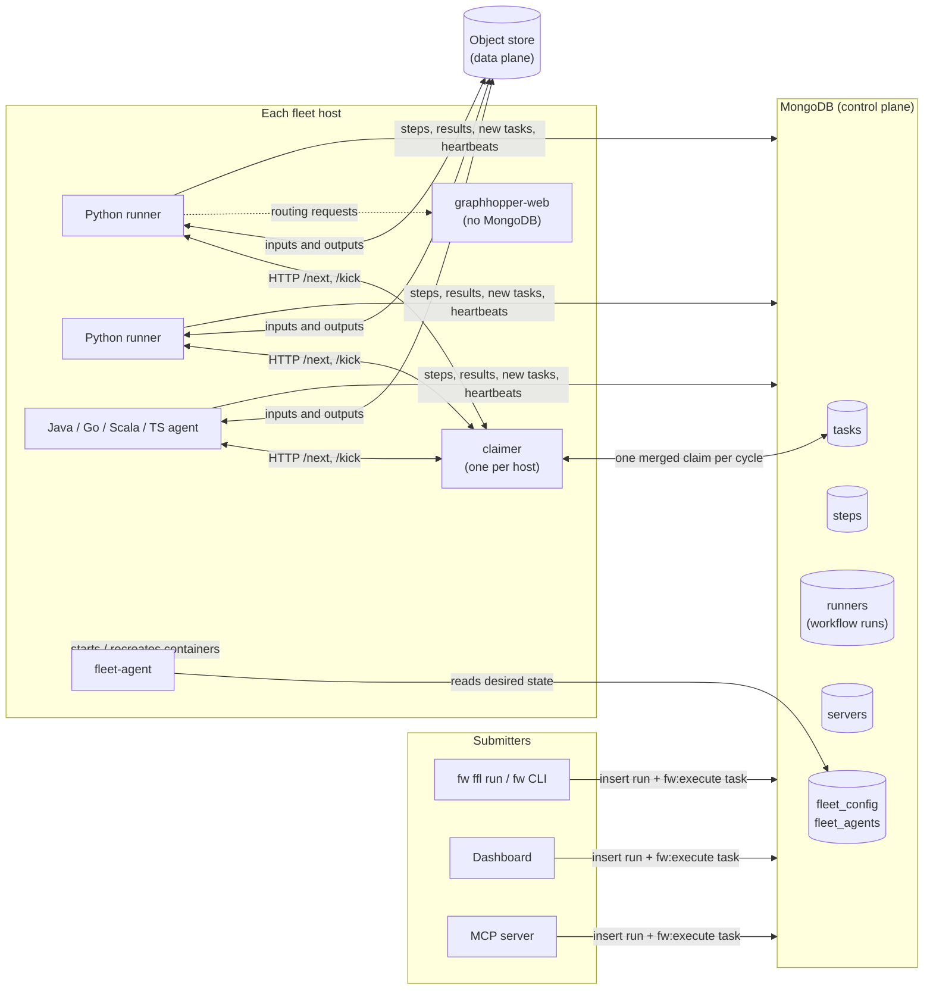
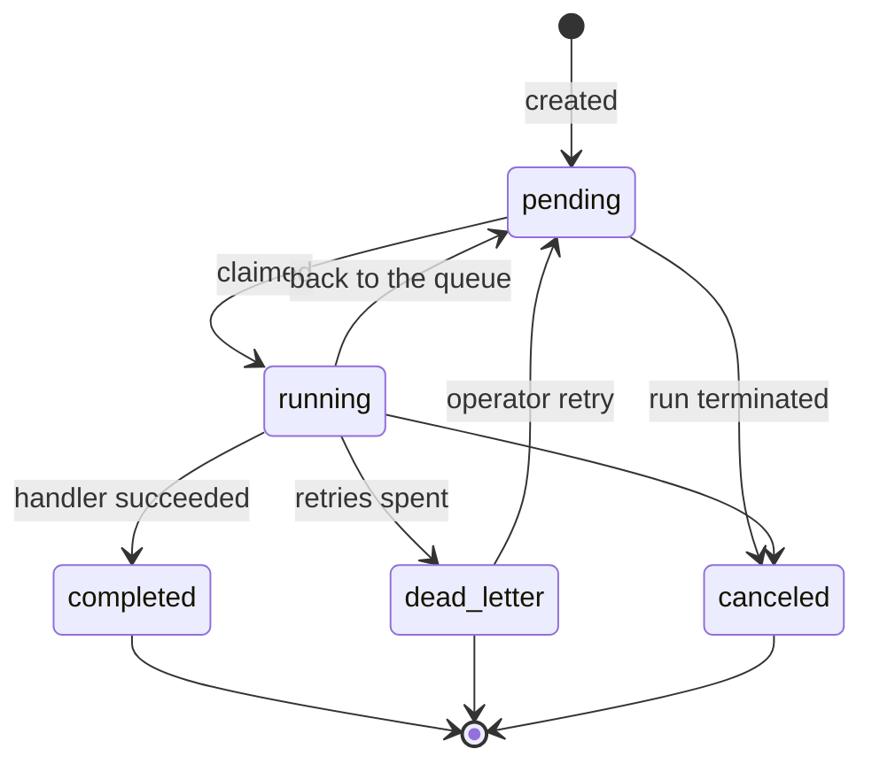
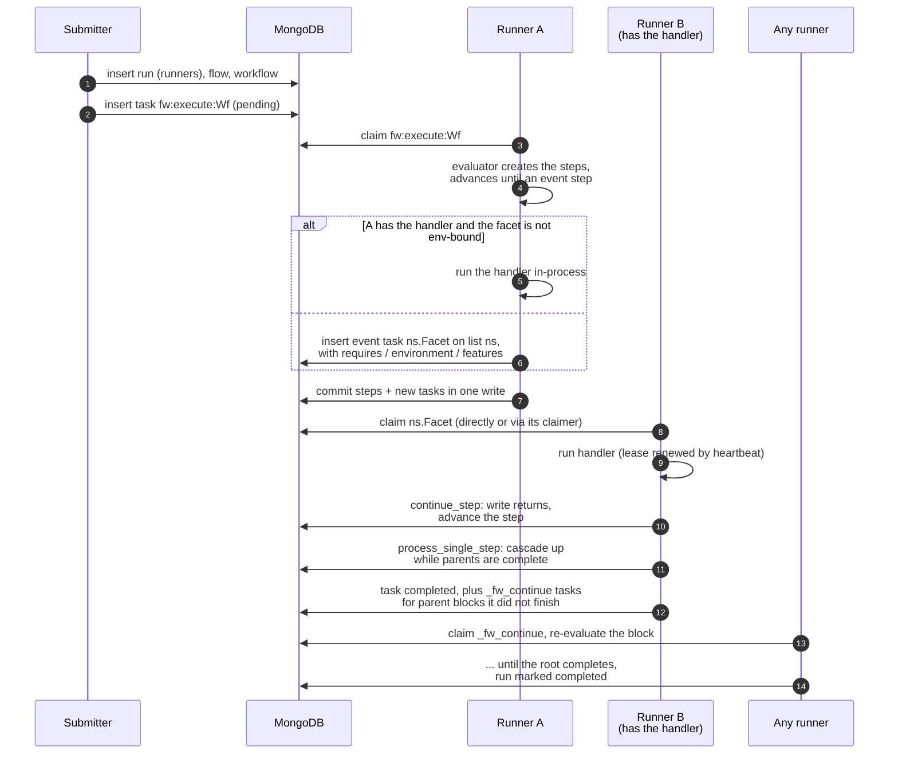
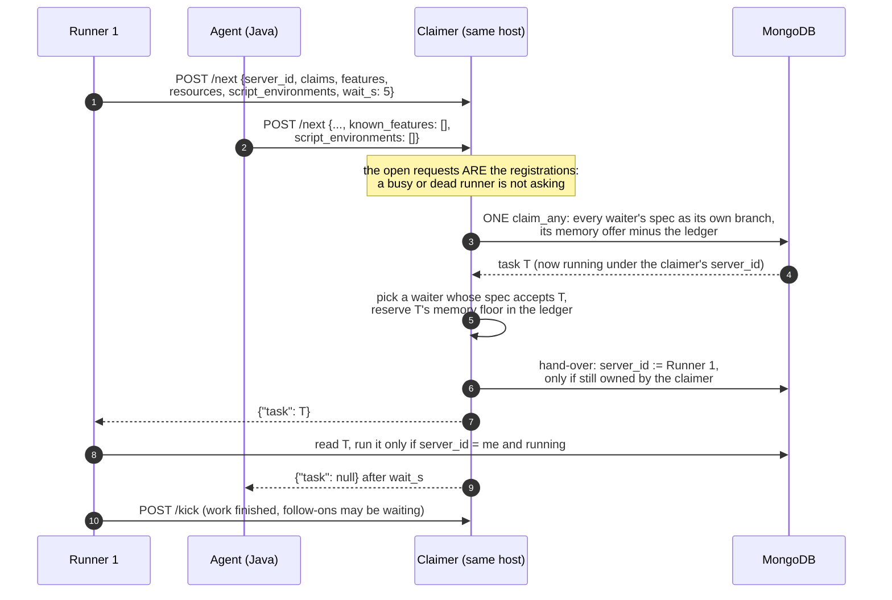
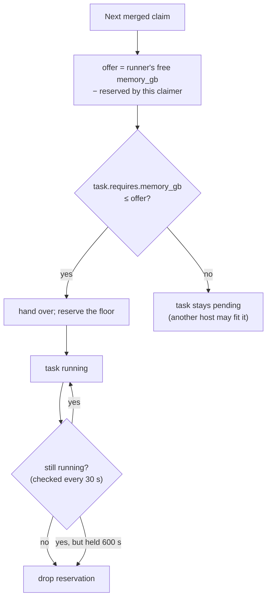
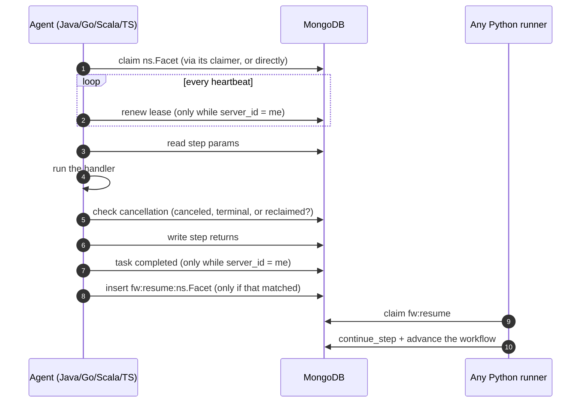
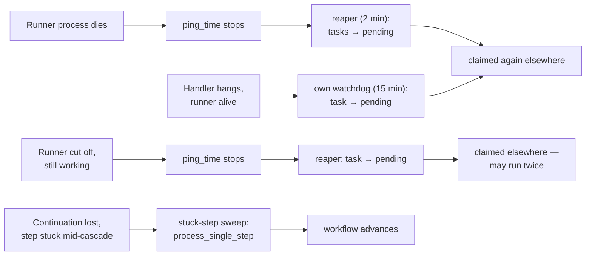

# How work moves: tasks, runners, servers and the database

Facetwork has **no message bus**. Every message between processes is a document
in MongoDB: a run is started by inserting a task, a step is handed to another
machine by inserting a task, a finished step tells its parent by inserting a
task, and a process proves it is alive by updating its server record. Nothing
is pushed; everything is polled and claimed with a single atomic write.

There are two exceptions, and both stay on one machine or are not control
traffic at all:

- the **per-host claimer** answers its own runners over HTTP (`POST /next`,
  `POST /kick`) on the host's compose network (§6.3);
- handlers call engine servers such as graphhopper-web over HTTP. That is a
  handler's data traffic, not coordination: those servers never touch MongoDB.

This page shows how the pieces exchange those documents. The deeper
mechanics are in [runtime-impl.md §17](runtime-impl.md#17-task-resilience-and-workflow-recovery)
(claiming and recovery), the [agent protocol](../../agents/protocol/README.md)
(external agents) and [execution-semantics.md](execution-semantics.md) (what is
guaranteed).

---

## 1. The pieces

| Process | What it is | Reads | Writes |
|---|---|---|---|
| **Submitter** (`fw ffl run`, dashboard, MCP) | starts a run | compiled flows | `flows`, `workflows`, `runners`, one `fw:execute` task |
| **Python runner** (`python -m facetwork.runtime.runner --registry`) | claims tasks, runs handlers and script tasks, advances workflows | `tasks`, `steps`, compiled ASTs | `tasks`, `steps`, `step_logs`, its `servers` record |
| **External agent** (Java, Go, Scala, TypeScript `AgentPoller`) | runs event-facet handlers in another language; no evaluator | `tasks`, `steps` | step returns, task state, `fw:resume` tasks, its `servers` record |
| **Claimer** (`facetwork/runtime/claimer.py`, one per host) | claims for every runner on its host | `tasks` | task ownership, its own `servers` record |
| **fleet-agent** (one per host, launchd/systemd) | makes the host's containers match `fleet_config` | `fleet_config`, `fw:agent:<host>` tasks | `fleet_agents`, containers |
| **Dashboard** | UI, plus a reaper that runs even when every runner is wedged | everything | recovery writes (§8) |
| **graphhopper-web** | routing engine a handler calls | the object store, at startup | nothing in MongoDB |

Every Python runner is the same program. None of them is a leader, and any of
them can start any workflow. What differs between them is which handlers they
loaded, and so which tasks they claim.

---

## 2. The collections

| Collection | One document per | Written by | Notes |
|---|---|---|---|
| `flows`, `workflows`, `afl_sources` | compiled program / workflow definition / published FFL | submitter, `fw ffl publish` | definitions: shared and immutable per version |
| `runners` | **workflow run** | submitter, then runners | ⚠️ the name is historical: a "runner" document is a *run*, and its `uuid` is the run id `fw maint repair-workflow` takes. Runner *processes* live in `servers` |
| `steps` | step of a run | runners (evaluator), agents (returns only) | the state machine; params and returns live here |
| `tasks` | unit of claimable work | see §3 | the queue. Every cross-process hand-off is a task |
| `step_logs` | log line on a step | runners, agents | what the dashboard shows under a step |
| `servers` | runner, agent or claimer **process** | that process | heartbeat (`ping_time`), capacity (`resources`), live `free_resources`, `handlers`, `provided_environments`, `ast_features` |
| `handler_registrations` | facet → Python module | `fw ffl seed`, MCP | what a `--registry` runner may load |
| `fleet_config` | desired fleet state (versioned) | `fw fleet set` / `rollout` | images, roles, server groups, `claimer_hosts` |
| `fleet_agents` | fleet host | that host's fleet-agent | which config version the host has applied |
| `leases` | singleton background job | whoever holds it | e.g. one dashboard reaper fleet-wide; the lease expires rather than being assigned |

Bulk data never goes through MongoDB. Handlers read and write the object
store, and a step's returns carry portable `s3://` URIs.

---

## 3. A task is a message

A task document says "someone who can do X, please do it". Its fields are
the whole addressing scheme:

| Field | Role |
|---|---|
| `name` | what to do: a facet name, or a protocol name such as `fw:execute:<Workflow>` |
| `task_list_name` | which queue: the facet's top-level namespace (`osm.cache.Download` → `osm`) |
| `state` | `pending` → `running` → `completed` / `failed` / `dead_letter` (§4) |
| `server_id` | the process that holds it. Every later write by the holder is conditioned on it |
| `lease_expires`, `task_heartbeat` | proof the holder is still working |
| `environment_hash`, `kind` | a script task's environment; only runners providing it may claim |
| `required_features` | FFL constructs the executor must understand |
| `requires` | resource floor, e.g. `{"memory_gb": 12}` |
| `retry_count`, `max_retries`, `next_retry_after` | retry budget and backoff |
| `step_id`, `workflow_id`, `runner_id` | which step of which run this serves |
| `data` | the payload (params) |

The kinds of task in use:

| `name` | Created by | Claimed by | Means |
|---|---|---|---|
| `fw:execute:<Workflow>` | submitter | any Python runner (list = the workflow's namespace, else `default`) | start this run |
| `<ns.Facet>` (event task) | the runner advancing a step whose handler it cannot run in-process | a runner or agent with that handler, polling list `<ns>` | run this handler for this step |
| `<ns.Facet>`, `kind: script` | the runner advancing an environment-bound script step | any runner providing `environment_hash` | run this script in that environment |
| `fw:resume:<Facet>` | an external agent, after writing the step's returns | any Python runner | the step has a result: advance the workflow |
| `_fw_continue` (list `_fw_continue`) | a runner that finished a step but left parent blocks to re-evaluate | runners polling the shared continuation list | re-evaluate this block |
| `fw:sys:<server uuid>` | `fw runner sys` | exactly that runner process | status / pause / resume (see [open items](../operations/open-items.md)) |
| `fw:agent:<host>` | `fw fleet agent-cmd` | that host's fleet-agent | status / recreate / restart |

A runner that advances a workflow runs an event step **in-process** when it
has the handler and the facet is not environment-bound. In that case no task
exists for the step at all. A task is created only when the work has to
cross to another process. That is why a run's task count is usually smaller
than its event-step count.

---

## 4. Task states

| Transition | Why |
|---|---|
| pending → running | a claim (§6): sets `server_id` and `lease_expires` |
| running → pending | the handler failed with retry budget left (`retry_count+1`, backoff in `next_retry_after`); the holder had no handler for it; the holder died (dead-server reaper); it ran past its timeout (watchdog) |
| running → running | its lease expired and another process reclaimed it (`retry_count+1`) |
| running → dead_letter | retry budget spent, or the handler raised a permanent error |
| → canceled | `fw maint terminate-workflow` |
| dead_letter → pending | `fw maint dead-letters --retry` or `repair-workflow`, which also resets `retry_count` |

`failed` exists for terminal failures the runtime records itself. Handlers do
not write it: an agent that wrote `failed` for a handler error would be retried
forever, because the stuck-step sweep sees no live task and creates a fresh
one ([agent protocol](../../agents/protocol/README.md)).

---

## 5. The life of a workflow run

A run whose middle step's handler lives on another machine:

Steps 10–13 are why no runner "owns" a workflow. Whoever completes a step
advances it as far as it can, and leaves a continuation for the rest. Two
processes touching the same step are kept apart by a version number on the
step (an optimistic concurrency check), not by a lock
([runtime-impl.md §17.5.3](runtime-impl.md#1753-per-step-processing-process_single_step-v0450)).

---

## 6. Claiming

### 6.1 What decides who may claim a task

A claim is one `find_one_and_update` that moves a task from `pending` to
`running`. Its filter carries every routing rule, so a process can only ever
take work it is able to finish:

| Dimension | Task side | Process side | Absent means |
|---|---|---|---|
| Name | `name` | handler names it loaded (exact, or `<name>:` prefix) | — |
| Queue | `task_list_name` | namespaces of its handlers + `--task-list` | — |
| Environment | `environment_hash` (script tasks) | `provided_environments` | default environment |
| FFL features | `required_features` | `ast_features` it understands | any executor |
| Resources | `requires` (`memory_gb`, `scratch_gb`, …) | `min(capacity, free now)` per dimension | unconstrained |
| Backoff | `next_retry_after` | clock | claimable now |

A script task is matched by environment instead of name and list. The other
filters apply to it exactly as to a handler task. (Before 2026-10-21 the
script branch filtered on environment alone, so a memory floor on a script
facet was ignored. Found while testing the claimer's memory ledger live; see
§6.4.)

A process that claims a running task whose `lease_expires` has passed is
**reclaiming** it, so that claim counts as a retry.

### 6.2 Claiming directly

Without a claimer, each runner asks for itself. One `claim_any` call folds
every kind of work it serves into a single `$or` query. Many runners race
for the same task, and the database's per-document atomicity picks exactly
one winner; the others get nothing and ask again. An idle runner backs off
until it asks once every 5 s (`FW_POLL_IDLE_MAX_MS`).

### 6.3 Claiming through the host's claimer

With `fw fleet set --claimer` a host runs one claimer, and its runners and
agents ask it instead of the database:

- **One query per host.** Each waiter's spec becomes its own branch, carrying
  that waiter's features and memory, so the merged query claims exactly what
  the runners would have claimed themselves. Idle claim traffic fell from about
  190 `findAndModify`/s fleet-wide (before October 2026) to 2.1/s with claimers
  on every host.
- **Ownership is never ambiguous.** The claimer claims under its own
  heartbeated server record, then hands over with a write conditioned on still
  owning the task. If the claimer dies in between, the dead-server reaper
  returns the task to the queue. If no waiter can take it any more, the claimer
  releases it.
- **A missing claimer makes a host noisier, never stuck.** A runner that cannot
  reach it claims directly for 60 s, then tries the claimer again.
- graphhopper-web containers neither claim nor connect to MongoDB, so they
  have nothing to route through a claimer.

### 6.4 The memory ledger

Runners advertise memory **free now**, and a claim checks it but reserves
nothing. A task's process takes minutes to grow to its floor, and until it
does the memory still looks free. So without a ledger, three runners on one
host could each see "15 GB free" and start three 12 GB builds in the same
second (measured 2026-10-16 and 2026-10-19).

The claimer keeps the reservations. When it hands out a task with
`requires.memory_gb`, it subtracts that amount from what every later claim on
that host offers. The reservation is dropped when the task stops running
(checked every 30 s) or after `FW_CLAIMER_RESERVE_HOLD_S` (600 s), whichever
comes first.

The ledger is per host. Hosts don't share reservations, and they don't need
to: each host's free memory is its own.

**Measured 2026-10-21.** The test was three script tasks, each declaring
`Requires(memory_gb = 30)` and allocating nothing, so live free memory never
dropped. One host had 41.8 GB free and seven idle runners waiting on its
claimer; no other host had 30 GB. The claimer handed out one task at a time,
with the next starting in the same 5-second sample the previous one finished
(11:46:50, 11:48:22, 11:49:55; 30 GB reserved throughout). The same test run
before the script-branch fix (§6.1) started all three at once, on a host
reporting 20 GB free.

---

## 7. External (polyglot) agents

An agent runs handlers but no evaluator. It sends results back through the
database, and a Python runner advances the workflow:

On a handler error the agent puts the task back to `pending` with backoff,
or `dead_letter` once the budget is spent. The rules are stated as data in
`agents/protocol/conformance/*.json` and checked by every library's tests.

---

## 8. Liveness and recovery

Nothing in the system blocks waiting for a reply. Each failure shows up as a
timestamp that stopped moving, and some process acts on it:

| Signal | Written by | Watched by | After (default) | Action |
|---|---|---|---|---|
| `servers.ping_time` | every runner, agent, claimer (heartbeat, 30 s) | every runner's reaper (every 60 s), dashboard reaper | `FW_REAPER_TIMEOUT_MS` = 2 min | mark the server `shutdown`; its running tasks without a fresh task heartbeat → `pending` |
| `tasks.lease_expires` | holder, renewed by heartbeat | any claim (lease reclaim, at most every 30 s) | `FW_LEASE_DURATION_MS`, derived: execution timeout + 1 min = 16 min | another process reclaims it (`retry_count+1`) |
| execution clock | the holder itself | the holder's watchdog | `FW_TASK_EXECUTION_TIMEOUT_MS` = 15 min | abandon the handler, task back to `pending` |
| `tasks.task_heartbeat` / `updated` | handler progress | stuck-task watchdog | task `timeout_ms`, else `FW_STUCK_TIMEOUT_MS` = 30 min | task → `pending` |
| step stuck mid-cascade | — | stuck-step sweep (every runner) | a few seconds to 5 min | re-run `process_single_step`; create a missing event task |
| the process's own futures vs `tasks` | — | reconcile (every 10 s) | — | free a slot whose task someone else reaped; reset a running task this process does not hold |

The lease deliberately outlasts the execution timeout. That way a wedged
handler is abandoned by its own runner before any other runner may reclaim
the task and run it a second time. Even so, delivery is **at least once**: a
runner that is alive but cut off keeps working while the reaper hands its
task to someone else. Handlers must therefore be safe to run twice,
concurrently ([execution-semantics.md](execution-semantics.md)).

---

## 9. Fleet control messages

Fleet control uses the same pattern, a document that something polls:

- **Desired state.** `fw fleet set …` writes a new `fleet_config` version.
  Every host's fleet-agent polls it, starts, stops or recreates containers to
  match, and records the version it applied in `fleet_agents`. That includes
  starting the claimer and setting `FW_CLAIM_PROXY_URL` on a host's runners.
  `fw fleet status` compares the two.
- **Commands to a host.** `fw fleet agent-cmd` inserts a `fw:agent:<host>`
  task, which only that host's fleet-agent claims.
- **Commands to one runner process.** `fw runner sys` inserts
  `fw:sys:<server uuid>`, addressed by process uuid because many runners share
  a host name. A paused runner keeps heartbeating, so the reaper doesn't treat
  it as dead. This channel's encoding is due to be redone
  ([open items](../operations/open-items.md)).

---

## 10. Where to go next

| Question | Read |
|---|---|
| Exact claim filters, continuation coalescing, every recovery layer | [runtime-impl.md §17](runtime-impl.md#17-task-resilience-and-workflow-recovery) |
| What delivery and idempotency guarantees hold | [execution-semantics.md](execution-semantics.md) |
| Writing an agent in another language | [agents/protocol/README.md](../../agents/protocol/README.md), [multi-language-handlers.md](../guides/multi-language-handlers.md) |
| Script tasks and environments | [script-environments.md](../architecture/script-environments.md) |
| Resource floors (`Requires`) and starvation | [CLAUDE.md → Resource-aware claim routing](../../CLAUDE.md) |
| Rolling out changes across the fleet | [fleet-rollouts.md](../operations/fleet-rollouts.md) |
